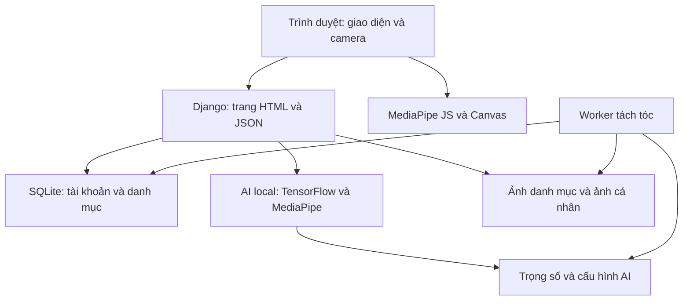
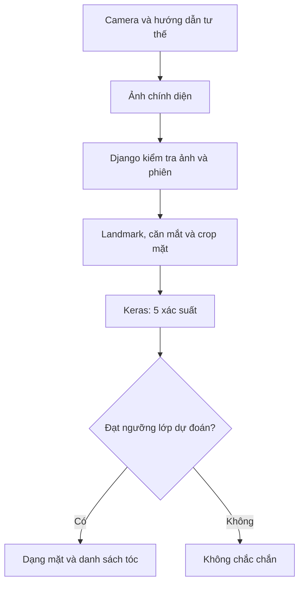
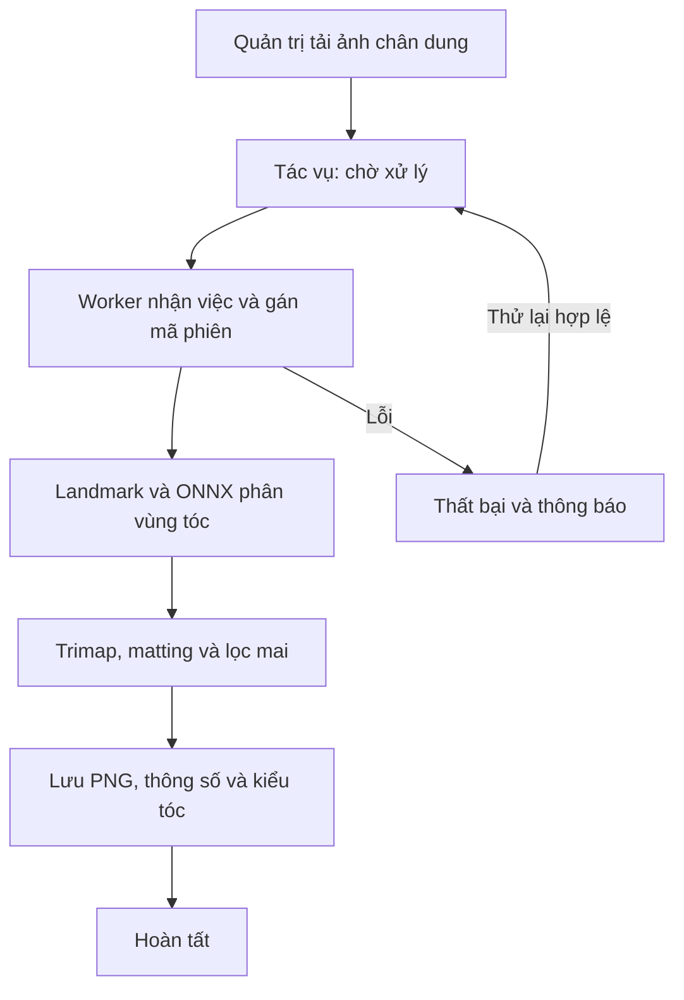
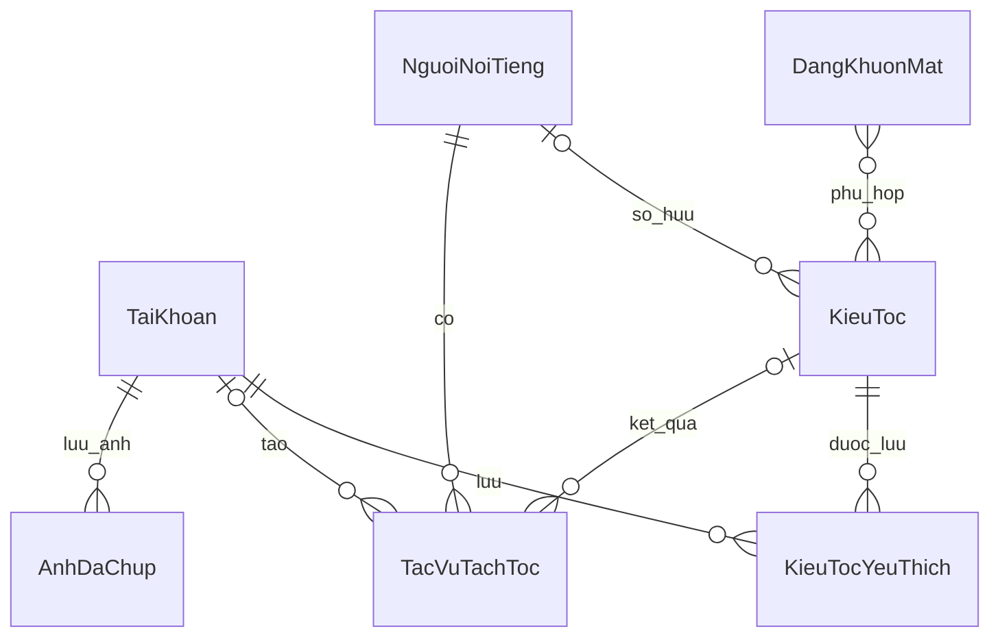

<div align="center">

# ✂️ HAULONGHAIR — Phân tích khuôn mặt & thử kiểu tóc

**Ứng dụng web Django phân loại 5 dạng khuôn mặt, gợi ý kiểu tóc theo danh mục và mô phỏng tóc PNG trên camera; tích hợp quản lý tài khoản, ảnh cá nhân và công cụ chuẩn bị mẫu tóc cho quản trị viên.**


[Tổng quan](#tong-quan) · [Tính năng](#tinh-nang) · [Kiến trúc](#kien-truc) · [Cài đặt](#cai-dat) · [Sử dụng](#su-dung) · [API](#api) · [Giới hạn](#gioi-han)

[Repository: VietHau1010/hair_ai](https://github.com/VietHau1010/hair_ai)

</div>

> **Phạm vi xác minh:** Tài liệu dựa trên mã nguồn HAULONGHAIR, bộ JSON cấu hình AI, JS/CSS đi kèm và thông tin môi trường Windows do chủ dự án cung cấp ngày 13/11/2026. Trạng thái “đã triển khai” thể hiện logic có trong mã nguồn, không đồng nghĩa đã chạy kiểm thử đầu cuối. Trọng số nhị phân, dữ liệu mẫu và môi trường chạy đầy đủ không nằm trong bộ mã nguồn dùng để biên soạn.
>
> **Xóa tóc thật:** Chưa hoàn thiện — không khả dụng trong phiên bản hiện tại. Tính năng này khác với **Tách tóc**, vốn còn có pipeline xử lý và hàng đợi quản trị.

## Mục lục

- [1. Tổng quan dự án](#tong-quan)
- [2. Chức năng và trạng thái](#tinh-nang)
- [3. Kiến trúc hệ thống](#kien-truc)
- [4. Luồng xử lý nghiệp vụ và AI](#luong-xu-ly)
- [5. Công nghệ và phiên bản](#cong-nghe)
- [6. Cơ sở dữ liệu và lưu trữ](#du-lieu)
- [7. Mô hình và tài nguyên](#tai-nguyen)
- [8. Cấu hình huấn luyện và kết quả hiện có](#thuc-nghiem)
- [9. Cấu trúc thư mục](#cau-truc)
- [10. Cài đặt và khởi chạy trên Windows](#cai-dat)
- [11. Hướng dẫn sử dụng](#su-dung)
- [12. API và tuyến chức năng](#api)
- [13. Kiểm tra và kiểm thử](#kiem-thu)
- [14. Triển khai và vận hành](#van-hanh)
- [15. Lỗi thường gặp](#loi-thuong-gap)
- [16. Giới hạn, tính năng chưa hoàn thiện và hướng phát triển](#gioi-han)
- [17. Đóng góp, tham khảo, tác giả và giấy phép](#tham-khao)

---

<a id="tong-quan"></a>
## 1. Tổng quan dự án

HAULONGHAIR hỗ trợ người dùng tìm hiểu kiểu tóc phù hợp với hình dáng khuôn mặt và xem trước mẫu tóc thông qua camera. Hệ thống kết hợp mô hình phân loại khuôn mặt chạy tại backend với MediaPipe theo dõi khuôn mặt trên trình duyệt, sau đó ghép ảnh tóc nền trong suốt lên khung hình.

Các mục tiêu chính:

- Phân loại khuôn mặt vào một trong 5 nhóm: trái tim, dài, trái xoan, tròn và vuông.
- Đưa ra gợi ý từ quan hệ giữa dạng mặt và kiểu tóc do quản trị viên thiết lập.
- Cho phép thử nhóm tóc phù hợp, nhóm phá cách và mẫu tóc người nổi tiếng.
- Hỗ trợ điều chỉnh tóc, chụp ảnh, ghép khung, tải kết quả và quản lý ảnh theo tài khoản.
- Cung cấp khu vực quản trị để xây dựng danh mục tóc, phân quyền và chuẩn bị PNG bằng tách tóc tự động hoặc tải PNG có sẵn.

### Đối tượng sử dụng

| Đối tượng | Phạm vi |
| :--- | :--- |
| Khách truy cập | Xem trang chủ, danh mục kiểu tóc và tìm tóc người nổi tiếng |
| Người dùng đã đăng nhập | Quét khuôn mặt, thử tóc, lưu kiểu tóc yêu thích, quản lý thông tin và ảnh của mình |
| Nhân sự quản trị | Vào quản trị khi tài khoản còn hoạt động, có `is_staff` và các quyền model tương ứng |
| Quản trị viên cấp cao | Quản lý toàn hệ thống, tài khoản và nhóm quyền |

### Phạm vi phiên bản hiện tại

Đây là hệ thống web với AI suy luận tại máy chạy Django. File [`thu_toc/ket_noi_colab.py`](thu_toc/ket_noi_colab.py) giữ tên cũ để tương thích nhưng không gọi Colab/ngrok trong luồng nhận diện hiện tại. Việc thử tóc là ghép ảnh 2D, không phải sinh tóc 3D hay dựng lại vùng da đầu bằng mô hình tạo sinh.

Các ứng dụng Django thực tế là `tai_khoan`, `kieu_toc`, `thu_toc`. Các tên `ai_khuon_mat` và `tach_toc` dưới `tai_nguyen/` là nhóm tài nguyên; không phải ứng dụng Django độc lập trong `INSTALLED_APPS`.

<a id="tinh-nang"></a>
## 2. Chức năng và trạng thái

“Đã triển khai” trong bảng dưới đây nghĩa là đã đối chiếu tuyến gọi và logic trong mã nguồn. Chức năng phụ thuộc đủ tài nguyên, dữ liệu và môi trường tương thích để sử dụng được.

| Nhóm | Chức năng | Mô tả | Đối tượng | Trạng thái |
| :--- | :--- | :--- | :--- | :--- |
| Tài khoản | Đăng ký, đăng nhập, đăng xuất | Email duy nhất; tài khoản tự đăng ký không có quyền quản trị | Khách/người dùng | Đã triển khai |
| Tài khoản | Thông tin cá nhân, đổi mật khẩu | Sửa họ, tên, email; kiểm tra mật khẩu hiện tại và giữ phiên sau đổi mật khẩu | Người dùng | Đã triển khai |
| Danh mục | Kiểu tóc theo dạng mặt | Lọc 5 dạng mặt, xem ảnh và mô tả | Mọi người | Đã triển khai |
| Danh mục | Kiểu tóc yêu thích | Lưu/bỏ lưu; không tạo trùng cùng tài khoản và kiểu tóc | Người dùng | Đã triển khai |
| Khám phá | Tóc người nổi tiếng | Tìm theo tên/tên gọi khác và kiểu tóc, phân trang | Mọi người | Đã triển khai |
| AI | Phân loại dạng mặt | Mô hình Keras; ngưỡng chấp nhận riêng từng lớp, có kết quả không chắc chắn | Người dùng | Đã triển khai |
| Gợi ý | Hợp khuôn mặt, phá cách | Truy vấn danh mục theo liên kết dạng mặt và cờ hiển thị | Người dùng | Đã triển khai |
| Mô phỏng | Camera và bám khuôn mặt | Landmark trên trình duyệt, chọn người và kiểm tra tư thế trước quét | Người dùng | Đã triển khai |
| Mô phỏng | Ghép và chỉnh tóc PNG | Điểm neo, kích thước, dịch chuyển, góc xoay và độ sáng | Người dùng | Đã triển khai |
| Ảnh | Chụp đơn, ghép khung, tải ảnh | Vẽ khung hình bằng Canvas; kết xuất ảnh từ giao diện | Người dùng | Đã triển khai |
| Ảnh | Lưu/xem/xóa ảnh cá nhân | Bản ghi gắn chủ sở hữu; đọc file qua view có kiểm tra tài khoản | Người dùng | Đã triển khai |
| Ảnh | Thao tác chia sẻ | Luồng chia sẻ/tải ảnh phụ thuộc trình duyệt và ứng dụng đích | Người dùng | Đã triển khai ở giao diện; cần kiểm tra trên thiết bị đích |
| Quản trị | Tóc và dạng mặt | Thêm, sửa, xóa, tìm kiếm, lọc, bật/tắt hiển thị | Staff có quyền | Đã triển khai |
| Quản trị | Người nổi tiếng | Hồ sơ, nhiều mẫu tóc, PNG thủ công và căn chỉnh mẫu | Staff có quyền | Đã triển khai |
| Quản trị AI | Tách tóc | Nhận ảnh một người, đưa vào hàng đợi; xuất PNG tóc và thông số ghép | Staff có quyền | Đã triển khai; cần worker riêng |
| Phân quyền | Tài khoản, nhóm, quyền | Quyền theo model; quản lý tài khoản/nhóm chỉ cho superuser | Superuser | Đã triển khai |
| Nghiên cứu | Xóa tóc thật | Loại bỏ tóc trên ảnh để hỗ trợ thử mẫu mới | Chưa cung cấp | **Chưa hoàn thiện — không khả dụng trong phiên bản hiện tại** |

### Phân biệt ba thao tác dễ nhầm

| Thao tác | Ý nghĩa |
| :--- | :--- |
| Tách tóc | Trích phần tóc từ ảnh chân dung thành PNG có alpha để tạo mẫu thử |
| Xóa kiểu tóc trong quản trị | Xóa bản ghi mẫu tóc khỏi danh mục; không chỉnh tóc trên ảnh |
| Xóa tóc thật | Chỉnh ảnh để loại bỏ tóc đang có trên đầu; hiện không khả dụng |

<a id="kien-truc"></a>
## 3. Kiến trúc hệ thống



| Thành phần | Vai trò và căn cứ |
| :--- | :--- |
| `config` | Cấu hình Django, URL gốc, WSGI/ASGI; đọc `.env` và cấu hình static/media |
| `tai_khoan` | Model người dùng kế thừa `AbstractUser`, biểu mẫu, xác thực và thông tin tài khoản |
| `kieu_toc` | Dạng mặt, mẫu tóc, yêu thích, người nổi tiếng và tác vụ tách tóc; danh mục công khai |
| `thu_toc` | Trang chủ, phòng thử, API nhận dạng, ảnh cá nhân, quản trị tùy biến và xử lý ảnh |
| AI local | Nạp Keras/landmarker khi cần, kiểm tra hash, khóa suy luận và tái sử dụng model |
| Trình duyệt | Camera, theo dõi landmark qua Web Worker, Canvas ghép tóc/chụp ảnh |
| Worker | Management command `xu_ly_tach_toc`, nhận việc từ bảng `TacVuTachToc` |

Hàng đợi hiện tại nằm trong SQLite; worker thăm dò định kỳ. Không có cấu hình Celery, Redis, broker hay dịch vụ microservice trong bộ mã nguồn được kiểm tra.

`/admin/` được trỏ vào [`thu_toc/duong_dan_quan_tri.py`](thu_toc/duong_dan_quan_tri.py), là giao diện quản trị tùy biến. Không mặc định xem đây là `django.contrib.admin.site.urls`. Module `config/bo_nap_giao_dien.py` tồn tại nhưng cấu hình `TEMPLATES` được cung cấp chưa gọi hàm cài đặt bộ nạp đó.

<a id="luong-xu-ly"></a>
## 4. Luồng xử lý nghiệp vụ và AI

### 4.1. Quét và phân loại khuôn mặt



1. Người dùng đăng nhập và mở phòng thử tóc. Trình duyệt xin quyền camera, tải MediaPipe và theo dõi mặt.
2. Giao diện hướng dẫn 5 tư thế, kiểm tra chất lượng và chọn ảnh chính diện để gửi lên backend. Đây không phải lấy trung bình dự đoán 5 ảnh tư thế.
3. `POST /api/face/predict/` nhận multipart trường `anh`, kiểm tra dung lượng tối đa `8 × 1024 × 1024` byte, mỗi chiều tối thiểu 48 px và tổng tối đa 20 triệu pixel.
4. Backend sửa chiều EXIF, chuyển RGB, thu ảnh về tối đa 1600 px mỗi cạnh. MediaPipe được cấu hình tối đa 2 mặt để phát hiện và từ chối ảnh không có đúng một mặt.
5. Căn thẳng theo hai mắt, lấy vùng khuôn mặt từ contour, áp mặt nạ và thêm margin 0,1. Vùng crop quá nhỏ được từ chối.
6. Crop thu tối đa 512 px, mã hóa JPEG quality 95 rồi giải mã bằng TensorFlow để thống nhất tiền xử lý. Dùng `resize_with_pad` về 300 × 300; làm tròn về uint8 rồi chuyển `float32` trong khoảng **0–255, không chia 255**.
7. Chạy model trên ảnh gốc và ảnh lật ngang khi TTA bật; lấy trung bình xác suất. Chọn lớp có xác suất lớn nhất, so sánh ngưỡng của chính lớp đó.
8. Nếu chấp nhận, trả dạng mặt và truy vấn danh mục tóc. Nếu không, trả `chap_nhan=false`, `dang_mat=null`, nhãn hiển thị “Không chắc chắn”. Không có mặt hoặc nhiều mặt cũng là kết quả nghiệp vụ có thể trả HTTP 200.

Suy luận được bảo vệ bởi `threading.Lock` trong mỗi tiến trình. Khi một ảnh đang xử lý, yêu cầu khác có thể nhận 503 thay vì xếp hàng chờ. Giao diện giới hạn chờ lượt quét 60 giây; hủy chờ phía trình duyệt không bảo đảm dừng phép tính đang chạy tại backend.

### 4.2. Gợi ý kiểu tóc

Nguồn quyết định là dữ liệu quản trị, không phải mô hình học gợi ý kiểu tóc độc lập:

- **Hợp khuôn mặt:** tóc thông thường (`nguoi_noi_tieng IS NULL`), đang hiển thị và có quan hệ `dang_mat_phu_hop` với lớp vừa được AI chấp nhận.
- **Phá cách:** tóc thông thường đang hiển thị, bật `hien_thi_pha_cach`, có ảnh thử tóc và không được gán phù hợp với dạng mặt vừa quét.
- **Người nổi tiếng:** luồng tìm riêng; chỉ lấy tóc và hồ sơ được hiển thị, có ảnh PNG thử tóc.

Danh sách phù hợp có thể chứa mẫu chỉ có ảnh giới thiệu: `co_the_thu` cho biết có PNG hay chưa. Không có gợi ý cũng có thể do danh mục trống hoặc chưa gán dạng mặt, không nhất thiết là lỗi AI.

### 4.3. Thử tóc trên camera

MediaPipe JavaScript chạy trong Web Worker, chế độ `VIDEO`, cấu hình tối đa 5 mặt. Bộ theo dõi duy trì định danh mặt và chỉ ghép tóc lên người đã quét được chấp nhận.

Canvas lấy độ rộng/chiều cao mặt và landmark trán số 10, dùng điểm neo của PNG cùng hệ số rộng, lệch ngang/dọc và góc hai mắt để biến đổi ảnh. Vị trí, độ rộng và góc được làm mượt theo thời gian. Giao diện hỗ trợ chỉnh kích thước, vị trí, góc xoay và độ sáng; xử lý lật ảnh tương ứng camera dạng gương.

Kết quả là ảnh tóc 2D chồng lên camera. Tóc thật ban đầu vẫn có thể lộ ra; góc quay lớn, vật che mặt, tóc dài hoặc mất landmark có thể ảnh hưởng chất lượng. Không có mô hình sinh tóc, xóa tóc thật hoặc mô phỏng che khuất 3D trong luồng này.

### 4.4. Tách tóc để tạo mẫu người nổi tiếng



Đầu vào: ảnh tĩnh JPEG/PNG/WEBP, tối đa 8 MiB, tối đa 20 triệu pixel, mỗi chiều ít nhất 128 px. Pipeline tại [`thu_toc/tach_toc.py`](thu_toc/tach_toc.py):

1. Đọc ảnh, sửa EXIF, thu cạnh xử lý tối đa 2560 px; nền alpha đầu vào được ghép lên nền xám sáng.
2. Dùng MediaPipe nhận diện đúng một mặt, kiểm tra kích thước mặt tối thiểu 48 px; cắt vùng đầu theo landmark.
3. Resize RGB về 512 × 512, chia 255 và chuẩn hóa theo mean/std ImageNet; chuyển NCHW.
4. OpenCV DNN chạy ONNX trên CPU, kiểm tra đầu ra 19 lớp; lớp tóc là 17.
5. Giữ cụm tóc chính gần đầu, loại vùng da/cơ thể/lông mày; tạo trimap chắc tóc, chắc nền và vùng chưa xác định.
6. PyMatting giải alpha với cạnh xử lý tối đa 900 px; làm mềm biên có hướng dẫn và lọc phần mai mỏng. RGB tóc được giữ từ ảnh đã tiền xử lý, không dùng mô hình tạo sinh tái tạo tóc.
7. Cắt PNG RGBA theo vùng tóc và điểm neo; xuất `diem_neo_x`, `diem_neo_y`, `ti_le_chieu_rong`, độ lệch và kích thước.
8. Worker tạo `KieuToc`, lưu ảnh giới thiệu JPEG và PNG vào media; cập nhật tác vụ trong transaction với điều kiện mã phiên còn hiệu lực.

Worker không tự khởi động cùng web. Khi thiếu worker, tác vụ ở trạng thái chờ. Cập nhật có điều kiện giúp tránh hai tiến trình nhận cùng việc và tránh phiên cũ ghi đè kết quả mới. Tác vụ đã có kiểu tóc liên kết không được tự ghi đè. Nếu lỗi, tác vụ ghi thông báo; chỉ tác vụ thất bại chưa có kết quả mới được đưa lại vào hàng đợi bằng nút thử lại.

Pipeline hiện thiên về giữ khối tóc nam ngắn và loại mai mỏng. Ảnh tóc chạm mép, tóc quá nhỏ hoặc không có vùng tóc đủ chắc chắn có thể bị từ chối. Có thể dùng PNG đã tách bên ngoài thay cho pipeline tự động.

### 4.5. Chụp và lưu ảnh cá nhân

Giao diện Canvas hỗ trợ ảnh đơn và ghép khung; module `chup_anh.js` tạo file kết quả và gửi khi người dùng chọn lưu. Backend:

- Chấp nhận JPEG/PNG/WEBP, tối đa 8 MiB, mỗi chiều từ 48 px, tổng tối đa 20 triệu pixel.
- Sửa EXIF, chuyển RGB và tái mã hóa PNG, không giữ metadata ảnh đầu vào.
- Lưu tên UUID trong `anh_ca_nhan/`; lưu chủ sở hữu, tên, loại và kích thước vào `AnhDaChup`.
- View đọc ảnh kiểm tra chủ sở hữu, trả `private, no-store`; tải file với `?tai=1`.
- Xóa ảnh qua POST sau kiểm tra chủ sở hữu. Ảnh ngoài quyền truy cập trả 404.

Ảnh quét AI không tự được ghi thành lịch sử phân loại trong các model hiện có. Ảnh cá nhân đã lưu là một chức năng lưu kết quả riêng.

<a id="cong-nghe"></a>
## 5. Công nghệ và phiên bản

### 5.1. Môi trường chủ dự án đã cung cấp

Các phiên bản sau lấy từ `.venv` trên Windows ngày 13/11/2026; đây là **môi trường quan sát được**, chưa phải lockfile hay ma trận tương thích đã kiểm thử trên máy mới.

| Nhóm | Công nghệ | Vai trò | Phiên bản/nguồn |
| :--- | :--- | :--- | :--- |
| Runtime | Python | Chạy Django và xử lý AI | 3.13.7 — lệnh `--version` |
| Backend | Django | ORM, session, form, routing, template | 5.2.18 — `.venv` |
| Database | SQLite | CSDL mặc định | Theo thư viện SQLite đi cùng Python; chưa xác định phiên bản engine |
| Deep Learning | TensorFlow / Keras | Nạp và suy luận mô hình dạng mặt | 2.20.0 / 3.13.2 |
| Landmark Python | MediaPipe | Phát hiện landmark cho AI local và tách tóc | 0.10.32 |
| Xử lý ảnh | NumPy | Mảng và phép tính | 2.1.3 |
| Xử lý ảnh | Pillow | Đọc ảnh, EXIF, PNG/JPEG | 12.3.0 |
| CV | opencv-contrib-python | `cv2`, biến đổi ảnh, ONNX DNN | 4.11.0.86 |
| Matting | PyMatting | Ước lượng alpha tóc | 1.1.16 |
| Cấu hình | python-dotenv | Đọc `cau_hinh_bi_mat.env` | 1.2.4 |
| Giao diện | HTML/CSS/JavaScript, Canvas, Web Worker | Trang web, camera, ghép/chụp ảnh | Mã nguồn trình duyệt, không có bước build Node trong bộ nguồn |
| Landmark JS | MediaPipe Tasks Vision | Theo dõi mặt trên trình duyệt | Script tải tài nguyên khai báo 0.10.21; bundle `.js` đang dùng chưa có metadata phiên bản riêng |
| Quản lý file lớn | Git LFS | Rule cho `*.safetensors` | Có trong `.gitattributes`; chưa xác minh file thực tế trong remote |

Môi trường còn có PyTorch, Diffusers, Transformers và Accelerate. Không thấy các thư viện này được gọi trong các luồng nhận dạng mặt, thử tóc và tách tóc hiện hành đã kiểm tra, nên không mặc định yêu cầu cài lại toàn bộ nhóm này. Sự hiện diện trong `pip list` không chứng minh một tính năng còn hoạt động.

### 5.2. Sai khác phiên bản giữa các nguồn

| Thành phần | `.venv` hiện tại | `export_manifest.json` | Nguồn khác |
| :--- | :--- | :--- | :--- |
| TensorFlow | 2.20.0 | 2.21.0 | `training_config.json`: 2.20.0 |
| Keras | 3.13.2 | 3.13.2 | — |
| MediaPipe | 0.10.32 | 1.1.0 | Metadata crop trong `inference_config.json`: 1.0.1 |
| NumPy | 2.1.3 | 2.1.3 | — |
| Pillow | 12.3.0 | 11.3.0 | — |

Giữ nguyên các nguồn để truy vết. Manifest ghi metadata của bản xuất, không phải kết quả kiểm tra môi trường đang chạy. Không suy ra phải nâng/hạ phiên bản chỉ từ bảng này; cần nạp model và kiểm thử ảnh thật trên môi trường đích trước khi chốt bộ phụ thuộc.

<a id="du-lieu"></a>
## 6. Cơ sở dữ liệu và lưu trữ

### 6.1. Model và quan hệ

| Model | Vai trò | Quan hệ/đặc điểm |
| :--- | :--- | :--- |
| `tai_khoan.TaiKhoan` | Người dùng | Kế thừa `AbstractUser`; email unique; có groups và user_permissions |
| `kieu_toc.DangKhuonMat` | Danh mục 5 dạng mặt | `ma` unique, dùng mã Heart/Oblong/Oval/Round/Square |
| `kieu_toc.KieuToc` | Mẫu tóc | Nhiều-nhiều với dạng mặt; người nổi tiếng tùy chọn; ảnh và thông số ghép |
| `kieu_toc.NguoiNoiTieng` | Hồ sơ tên/nghệ danh | Một hồ sơ có nhiều tóc và tác vụ; có cờ hiển thị |
| `kieu_toc.KieuTocYeuThich` | Lưu tóc theo người dùng | Unique theo cặp tài khoản/kiểu tóc; xóa liên đới theo FK |
| `kieu_toc.TacVuTachToc` | Hàng đợi và trạng thái xử lý | PROTECT người nổi tiếng; kết quả tóc/nguời tạo SET_NULL; có mã phiên và số lần xử lý |
| `thu_toc.AnhDaChup` | Metadata ảnh cá nhân | FK chủ sở hữu CASCADE; tên file unique; thời gian và kích thước |



Sơ đồ thể hiện quan hệ nghiệp vụ; bảng nối M2M và các bảng Django auth/session/contenttypes không được triển khai chi tiết trong hình.

### 6.2. Vị trí lưu

| Đường dẫn từ gốc dự án | Nội dung | Cách hình thành |
| :--- | :--- | :--- |
| `db.sqlite3` | Tài khoản, danh mục, quan hệ, tác vụ, metadata ảnh | Tạo khi migrate trên cài đặt mới hoặc nhận bản DB hợp lệ |
| `tai_nguyen/` | Static JS/CSS, WASM và model | Chuẩn bị trước; không nằm trong ZIP mã nguồn ban đầu |
| `tep_tai_len/kieu_toc/anh_gioi_thieu/` | Ảnh giới thiệu tóc | Model ImageField/storage tạo khi lưu |
| `tep_tai_len/kieu_toc/anh_thu_toc/` | PNG mẫu tóc | Upload thủ công hoặc worker tạo |
| `tep_tai_len/nguoi_noi_tieng/anh_goc/` | Ảnh đầu vào tác vụ | Tạo khi quản trị gửi ảnh |
| `tep_tai_len/nguoi_noi_tieng/anh_dai_dien/` | Vị trí ảnh đại diện theo model | Khi trường được sử dụng; form hồ sơ hiện không mở trường ảnh này |
| `anh_ca_nhan/` | PNG ảnh riêng đã chụp | Tạo khi người dùng lưu ảnh; không nằm dưới MEDIA_ROOT mặc định |

Database lưu đường dẫn/tên file và thuộc tính, không chứa nhị phân ảnh. Sao lưu riêng DB mà thiếu file sẽ làm bản ghi còn nhưng ảnh không hiển thị. Xóa bản ghi qua ORM không mặc định đảm bảo mọi file media liên quan đã bị xóa; cần đánh giá và dọn file mồ côi bằng quy trình riêng.

`migrate` chỉ tạo schema; các migrations được cung cấp không seed sẵn 5 dạng mặt hay mẫu tóc. Cài mới cần thêm danh mục và liên kết phù hợp qua quản trị. Không cần mang DB chứa tài khoản thật để chạy bản demo mới.

<a id="tai-nguyen"></a>
## 7. Mô hình và tài nguyên

Các đường dẫn dưới đây dựa trên code và kiểm kê file do chủ dự án cung cấp. Chỉ các file JSON/JS/CSS đã được cung cấp byte để đọc; trọng số không được mở hay chạy trong lần kiểm tra này.

| Thành phần | File/đường dẫn | Định dạng | Mức cần thiết và chuẩn bị |
| :--- | :--- | :--- | :--- |
| Dạng mặt | `tai_nguyen/ai_khuon_mat/model.keras` | Keras, 84.468.321 byte theo kiểm kê/manifest | Bắt buộc cho phân loại; nhận nguyên bộ AI đã xuất từ chủ dự án |
| Manifest | `tai_nguyen/ai_khuon_mat/export_manifest.json` | JSON | Bắt buộc để kiểm tra file, nhãn và checksum |
| Nhãn/ngưỡng | `face_shape_labels.json`, `face_shape_class_thresholds.json` cùng thư mục AI | JSON | Bắt buộc; không tự thay thứ tự hoặc ngưỡng |
| Cấu hình suy luận | `inference_config.json`, `calibration_config.json`, `test_seal.json` cùng thư mục AI | JSON | Bắt buộc; phải đồng bộ với model và manifest |
| Landmark backend | `tai_nguyen/ai_khuon_mat/face_landmarker.task` | MediaPipe Task | Bắt buộc cho phân loại; là file riêng so với bản dành cho trình duyệt |
| Cấu hình huấn luyện | `tai_nguyen/ai_khuon_mat/training_config.json` | JSON | Phục vụ truy vết; loader hiện không bắt buộc file này |
| Phân vùng tóc | `tai_nguyen/tach_toc/phan_tich_toc.onnx` | ONNX, 53.205.364 byte theo kiểm kê | Bắt buộc cho tách tóc tự động; code có tải khi thiếu |
| Landmark trình duyệt/tách tóc | `tai_nguyen/thu_toc/mediapipe/face_landmarker.task` | MediaPipe Task | Bắt buộc cho camera và tách tóc backend |
| Runtime trình duyệt | `tai_nguyen/thu_toc/mediapipe/vision_bundle.js`, `wasm/vision_wasm_internal.js`, `wasm/vision_wasm_internal.wasm`, `wasm/vision_wasm_nosimd_internal.js`, `wasm/vision_wasm_nosimd_internal.wasm` | JS/WASM | Bắt buộc cho camera MediaPipe; giữ nguyên bộ đang dùng |
| UI bổ sung | `tai_nguyen/thu_toc/anh_cua_toi.js`, `chup_anh.js`, `chup_anh.css`, `quan_tri_nguoi_noi_tieng.js`, `quan_tri_nguoi_noi_tieng.css` | JS/CSS | Cần cho các phần giao diện tương ứng |
| TFLite hiện có | `tai_nguyen/tach_toc/tach_toc.tflite`, `phan_vung_chi_tiet.tflite`, `tai_nguyen/thu_toc/mediapipe/phan_vung_toc.tflite` | TFLite | Có trong kiểm kê; chưa thấy nạp trong các luồng hiện hành được khảo sát; không mặc định bắt buộc |

### 7.1. Nguồn và cơ chế nạp

- Mô hình dạng mặt: metadata ghi backbone `efficientnetv2s`, phân loại 5 lớp. Bộ cấu hình có thông số fine-tuning; chưa có notebook/checkpoint huấn luyện để xác minh đầy đủ nguồn dữ liệu, pretrained ban đầu hoặc quá trình tái lập. Nhận bộ xuất từ chủ dự án; chưa có URL tải công khai của bộ này.
- Loader dùng `tf.keras.models.load_model(..., compile=False)`, kiểm tra SHA-256 của 7 file bắt buộc, đối chiếu calibration, thứ tự nhãn, hash model/ngưỡng với seal, rồi chạy một đầu vào giả để kiểm tra shape và tính hữu hạn.
- ONNX tách tóc: URL được khai báo trong code là [yakhyo/face-parsing — resnet18.onnx](https://github.com/yakhyo/face-parsing/releases/download/weights/resnet18.onnx). Dùng trọng số có sẵn; chưa có bằng chứng HAULONGHAIR tự huấn luyện mô hình phân vùng này.
- MediaPipe: dùng Face Landmarker có sẵn. Script tài nguyên trỏ vào kho model của MediaPipe và runtime `@mediapipe/tasks-vision` từ jsDelivr/unpkg.

Sáu JSON có mặt trong manifest và ZIP bổ sung đã được đối chiếu SHA-256, đều khớp. Chưa kiểm tra checksum `model.keras` và `.task` vì chưa có byte nhị phân. Không sửa JSON thủ công rồi bỏ qua kiểm tra hash để làm AI chạy.

### 7.2. Lưu ý script tải tài nguyên

[`cai_dat_tai_nguyen.py`](cai_dat_tai_nguyen.py) tải runtime MediaPipe và landmarker trình duyệt, **không tải bộ phân loại khuôn mặt**. Script ghi `vision_bundle.mjs`, trong khi template hiện tham chiếu `vision_bundle.js`. Vì vậy, chạy riêng script này chưa đảm bảo phòng thử tóc đủ tài nguyên. Cách chuẩn bị ưu tiên là nhận nguyên thư mục `tai_nguyen` đã dùng trên máy chủ dự án, giữ đúng cấu trúc; không tự đổi tên/ghi đè bundle đang hoạt động.

Pipeline tách tóc có thể tự tải ONNX nếu thiếu, nhưng cần mạng tới GitHub. Chạy offline cần chuẩn bị file ONNX trước. Không yêu cầu tải lại bất kỳ model “Xóa tóc thật” nào.

### 7.3. Git LFS

`.gitattributes` hiện chỉ khai báo `*.safetensors filter=lfs diff=lfs merge=lfs -text`. Không có rule cho `.keras`, `.onnx` hoặc `.task` trong bản được cung cấp. Không suy ra các file này được LFS quản lý.

Nếu clone bằng Git, có thể kiểm tra LFS theo hướng dẫn cài đặt ở dưới. Nếu gặp file chỉ vài dòng bắt đầu bằng `version https://git-lfs.github.com/spec/v1`, đó là con trỏ, không phải trọng số. ZIP nguồn được kiểm tra không có trọng số để đánh giá trường hợp này trực tiếp.

<a id="thuc-nghiem"></a>
## 8. Cấu hình huấn luyện và kết quả hiện có

### 8.1. Cấu hình xuất kèm mô hình

Theo `training_config.json`, cấu hình ghi nhận backbone EfficientNetV2S, ảnh 300 × 300, batch 16, `unfreeze=100`, stage 1 là 8 epoch với learning rate 0,001; stage 2 là 25 epoch với learning rate 0,00002; label smoothing 0,05, weight decay 0,0001, seed 42 và mixed precision bật. Tiêu chí chọn được ghi là `val_macro_f1_then_val_accuracy`.

Đây là cấu hình được lưu, không đủ để kết luận số epoch thực chạy, checkpoint tốt nhất, GPU sử dụng hoặc kết quả trên tập test. `test_seal.json` chứa định danh run/data/split, hash và calibration; không chứa bảng accuracy/F1 trên test. Bộ nguồn chưa có dữ liệu huấn luyện, notebook, script train hay quy trình tái tạo split.

### 8.2. Ngưỡng và số liệu validation lưu trong JSON

`calibration_config.json` ghi TTA bật, target precision 0,9, min coverage 0,35 và tối thiểu 10 mẫu validation được chấp nhận. Bảng sau chép các chỉ số từ `face_shape_class_thresholds.json` và làm tròn phần trăm để đọc:

| Lớp | Ngưỡng | `val_precision` | `coverage` | `accepted_val_count` | `predicted_val_count` |
| :--- | ---: | ---: | ---: | ---: | ---: |
| Heart | 0,414740 | 90,29% | 98,10% | 103 | 105 |
| Oblong | 0,577200 | 90,30% | 88,74% | 134 | 151 |
| Oval | 0,762534 | 90,12% | 47,37% | 81 | 171 |
| Round | 0,661435 | 90,15% | 79,04% | 132 | 167 |
| Square | 0,000000 | 92,59% | 100,00% | 135 | 135 |

Các trường count/coverage phản ánh metadata calibration được cung cấp; chưa có script đánh giá để xác minh đầy đủ cách định nghĩa và quy trình tính. Không diễn giải bảng này thành accuracy tổng thể, F1 hoặc tỷ lệ thành công khi thử tóc. Ngưỡng Square bằng 0 là giá trị lưu trong bản xuất, không phải lỗi chép tài liệu.

### 8.3. Phạm vi đánh giá còn thiếu

Chưa có kết quả test độc lập, confusion matrix, số lượng và nguồn ảnh toàn bộ dữ liệu, benchmark tốc độ, đo độ trễ có quy trình, đánh giá alpha/IoU tóc hay kiểm thử hiệu năng nhiều người dùng. Chưa có căn cứ xác định RAM tối thiểu hoặc cam kết thời gian suy luận. Các kết quả này cần được bổ sung cùng phương pháp đo và môi trường cụ thể.

<a id="cau-truc"></a>
## 9. Cấu trúc thư mục

Cây dưới đây tách mã nguồn hiện có với tài nguyên đã được chủ dự án kiểm kê và dữ liệu được tạo khi chạy.

```text
HAULONGHAIR/
├── manage.py
├── cai_dat_tai_nguyen.py          # Tải một phần runtime MediaPipe; xem lưu ý tên bundle
├── config/
│   ├── settings.py               # Django, SQLite, static/media, dotenv
│   ├── urls.py                   # URL gốc và quản trị tùy biến
│   ├── bo_nap_giao_dien.py        # Module bộ nạp hiện chưa được settings gọi
│   ├── asgi.py
│   └── wsgi.py
├── tai_khoan/
│   ├── models.py                 # TaiKhoan
│   ├── bieu_mau.py               # Đăng ký/đăng nhập/thông tin/đổi mật khẩu
│   ├── views.py
│   ├── duong_dan.py
│   ├── giao_dien/tai_khoan/
│   ├── migrations/
│   └── tests.py                  # Khung mặc định, chưa có ca test
├── kieu_toc/
│   ├── models.py                 # Tóc, dạng mặt, yêu thích, người nổi tiếng, tác vụ
│   ├── views.py                  # Danh mục và yêu thích
│   ├── kham_pha.py               # Tìm và serialize tóc người nổi tiếng
│   ├── duong_dan.py
│   ├── giao_dien/kieu_toc/
│   ├── migrations/
│   └── tests.py
├── thu_toc/
│   ├── views.py                  # Trang chủ, phòng thử, health, phân loại
│   ├── ket_noi_colab.py           # AI LOCAL, giữ tên cũ
│   ├── models.py                 # AnhDaChup
│   ├── xu_ly_anh.py               # Lưu/đọc/xóa ảnh riêng
│   ├── tach_toc.py                # Landmark + ONNX + matting; CLI độc lập
│   ├── xu_ly_tach_toc.py          # Nhận tác vụ và lưu kết quả
│   ├── quan_tri.py               # Quản trị danh mục, tài khoản, nhóm
│   ├── quan_tri_nguoi_noi_tieng.py # Hồ sơ và hàng đợi
│   ├── quan_tri_thu_cong.py       # PNG thủ công và xóa hồ sơ/tóc
│   ├── can_chinh_toc.py           # Căn mẫu, phát hiện xung đột khi lưu
│   ├── bieu_mau_quan_tri.py
│   ├── bieu_mau_nguoi_noi_tieng.py
│   ├── duong_dan.py
│   ├── duong_dan_quan_tri.py
│   ├── management/commands/
│   │   ├── chay_web.py           # Warmup AI trước khi mở HTTP
│   │   └── xu_ly_tach_toc.py     # Worker hàng đợi
│   ├── giao_dien/thu_toc/        # HTML, JS inline và giao diện quản trị
│   ├── migrations/
│   └── tests.py
├── tai_nguyen/                   # Chuẩn bị riêng; có trong kiểm kê máy chủ dự án
│   ├── ai_khuon_mat/             # Keras, JSON và landmark backend
│   ├── tach_toc/                 # ONNX và các TFLite hiện có
│   └── thu_toc/                  # JS/CSS và mediapipe/{JS, task, wasm}
├── db.sqlite3                    # Tạo khi migrate hoặc nhận DB có sẵn
├── tep_tai_len/                  # Tạo khi upload/lưu media
├── anh_ca_nhan/                  # Tạo khi lưu ảnh cá nhân
├── .gitattributes
├── .gitignore
└── README.md
```

Bộ ZIP mã nguồn không có `requirements.txt`, lockfile, Dockerfile, Compose, LICENSE hay bộ ảnh mẫu. Không có hướng dẫn 1-click `.bat` tương ứng trong bộ này.

<a id="cai-dat"></a>
## 10. Cài đặt và khởi chạy trên Windows

### 10.1. Điều kiện trước khi cài

- Windows, PowerShell và Python; môi trường quan sát là Python 3.13.7. Chưa xác minh nền tảng/kiến trúc khác.
- Git nếu lấy mã bằng clone; Git LFS nếu repository thực tế có file LFS.
- Trình duyệt hỗ trợ camera, WebAssembly, Canvas, ES module và Web Worker; cấp quyền camera cho website.
- Nguyên bộ tài nguyên đúng cấu trúc tại [mục 7](#tai-nguyen), đặc biệt bộ Keras/JSON và runtime MediaPipe.
- Có mạng khi cài Python packages hoặc tải model còn thiếu. Chưa xác định yêu cầu RAM/CPU tối thiểu bằng benchmark.

Không cần khóa API Colab cho pipeline AI local hiện tại. `settings.py` vẫn đọc `DIA_CHI_COLAB` và `KHOA_API_COLAB` từ `cau_hinh_bi_mat.env`, nhưng module suy luận hiện tại không dùng hai biến này. Không đưa file chứa bí mật vào README hay chia sẻ công khai.

### 10.2. Lấy mã nguồn — lần đầu

**PowerShell; đứng tại thư mục cha, ví dụ `D:\`:**

```powershell
git clone https://github.com/VietHau1010/hair_ai.git HAULONGHAIR
Set-Location .\HAULONGHAIR
```

Nếu đã có dự án tại `D:\HAULONGHAIR`, dùng thư mục đang có, không clone đè và không thay DB bằng bản trống.

**PowerShell; tại gốc HAULONGHAIR; khi cần kiểm tra LFS và đã cài Git LFS:**

```powershell
git lfs install
git lfs ls-files
```

Nếu có các file LFS cần dùng nhưng chưa tải, chạy `git lfs pull` tại gốc. LFS không lấy được những tài nguyên chưa được đưa lên repository; nhận riêng bộ xuất AI từ chủ dự án nếu clone vẫn thiếu.

### 10.3. Môi trường ảo — lần đầu trên máy mới

**PowerShell; tại gốc HAULONGHAIR; chỉ tạo nếu chưa có `.venv` cần giữ:**

```powershell
python --version
python -m venv .venv
```

Các lệnh sau gọi trực tiếp Python trong `.venv` để tránh nhầm Python hệ thống và không yêu cầu đổi ExecutionPolicy. Có thể kích hoạt bằng `.\.venv\Scripts\Activate.ps1` nếu chính sách máy cho phép, nhưng không bắt buộc.

### 10.4. Phụ thuộc — căn cứ và lệnh chuẩn bị

Bộ nguồn được kiểm tra chưa có `requirements.txt`; không có lệnh `pip install -r requirements.txt` hợp lệ để áp dụng nguyên trạng. Lệnh dưới đây là **bộ phụ thuộc trực tiếp được đối chiếu với import và phiên bản `.venv` đã cung cấp**, dành cho cài đặt mới; chưa được chạy tái lập trên máy sạch. Không chạy để thay đổi một môi trường đang hoạt động nếu không cần thiết.

**PowerShell; tại gốc HAULONGHAIR; lần đầu trên máy mới:**

```powershell
.\.venv\Scripts\python.exe -m pip install Django==5.2.18 python-dotenv==1.2.4 pillow==12.3.0 numpy==2.1.3 tensorflow==2.20.0 keras==3.13.2 mediapipe==0.10.32 opencv-contrib-python==4.11.0.86 PyMatting==1.1.16
```

Pip sẽ giải các phụ thuộc gián tiếp. Phiên bản ở trên là snapshot môi trường, không bảo đảm wheel và tương thích cho mọi máy. Nếu pip báo không tìm thấy bản phù hợp hoặc xung đột, giữ nguyên log và đối chiếu Python/kiến trúc với môi trường gốc; không tự đổi phiên bản model/config để né lỗi. Không cần thêm `opencv-python` bên cạnh `opencv-contrib-python` chỉ để có `cv2`.

**PowerShell; tại gốc HAULONGHAIR; kiểm tra môi trường sau chuẩn bị:**

```powershell
.\.venv\Scripts\python.exe -m pip check
.\.venv\Scripts\python.exe -m pip list --format=freeze
```

### 10.5. Chuẩn bị tài nguyên — lần đầu

Nhận thư mục `tai_nguyen` và đặt cạnh `manage.py`. Không giải nén toàn bộ JSON vào gốc; các file AI phải ở `tai_nguyen\ai_khuon_mat\`, JS/CSS ở `tai_nguyen\thu_toc\`.

**PowerShell; tại gốc HAULONGHAIR:**

```powershell
Test-Path .\tai_nguyen\ai_khuon_mat\model.keras
Test-Path .\tai_nguyen\ai_khuon_mat\export_manifest.json
Test-Path .\tai_nguyen\thu_toc\mediapipe\vision_bundle.js
Test-Path .\tai_nguyen\thu_toc\mediapipe\face_landmarker.task
Test-Path .\tai_nguyen\tach_toc\phan_tich_toc.onnx
```

`True` chỉ xác nhận tồn tại, chưa xác nhận file hợp lệ. Nếu bộ AI hash không khớp, nhận lại đúng bộ xuất đồng bộ. Không tự tạo manifest mới cho một model khác.

Script `cai_dat_tai_nguyen.py` có thể tải một phần runtime nhưng còn sai khác tên `.mjs`/`.js` đã nêu ở mục 7.2; không coi đây là phương án cài đầy đủ. Cần giải quyết bộ runtime đúng tên trước khi dùng camera.

### 10.6. Database và quản trị — lần đầu

Nếu chưa có DB, migrate tạo database mới. Nếu đã có DB đang dùng, sao lưu trước và chỉ áp migrations còn thiếu; không xóa DB để cài lại.

**PowerShell; tại gốc HAULONGHAIR:**

```powershell
.\.venv\Scripts\python.exe manage.py check
.\.venv\Scripts\python.exe manage.py showmigrations
.\.venv\Scripts\python.exe manage.py migrate
.\.venv\Scripts\python.exe manage.py createsuperuser
```

Tạo superuser bằng thông tin riêng. Không có tài khoản/mật khẩu mặc định trong tài liệu. Sau khi mở web, đăng nhập bằng trang `/tai-khoan/dang-nhap/`, rồi vào `/admin/` để chuẩn bị dữ liệu:

1. Thêm đủ 5 dạng mặt trong `/admin/dang-mat/`.
2. Thêm tóc thường ở `/admin/toc/`, gồm tên, mô tả, ảnh giới thiệu và PNG trong suốt nếu cần thử.
3. Gán dạng mặt phù hợp và bật hiển thị.
4. Thêm hồ sơ người nổi tiếng và PNG hoặc ảnh đầu vào tách tóc nếu cần nhóm khám phá.

Django development server phục vụ static từ `tai_nguyen` qua staticfiles, media từ `tep_tai_len` khi DEBUG bật. Không có `STATIC_ROOT` trong cấu hình hiện tại; không bắt buộc chạy `collectstatic` để dùng local và không coi lệnh đó là bước production hoàn chỉnh.

### 10.7. Khởi chạy web — mỗi lần sử dụng

**PowerShell cửa sổ 1; tại gốc HAULONGHAIR:**

```powershell
.\.venv\Scripts\python.exe manage.py chay_web 127.0.0.1:8000 --noreload
```

Lệnh nạp model, kiểm tra bộ xuất và chạy thử suy luận trước khi mở HTTP. Nếu không chuẩn bị được AI, lệnh báo lỗi và chưa mở website. `--noreload` tránh tự khởi động lại khi file thay đổi trong lúc chạy demo.

Khi cần kiểm tra riêng giao diện mà chưa chuẩn bị AI, có thể dùng development server thông thường; AI vẫn lỗi khi được gọi nếu thiếu tài nguyên:

**PowerShell; tại gốc HAULONGHAIR; chọn thay cho lệnh web trên, không chạy đồng thời cùng cổng:**

```powershell
.\.venv\Scripts\python.exe manage.py runserver 127.0.0.1:8000 --noreload
```

Mở [http://127.0.0.1:8000/](http://127.0.0.1:8000/). Camera cần secure context: loopback thường phù hợp cho local; truy cập bằng IP LAN qua HTTP có thể bị trình duyệt chặn camera.

### 10.8. Worker tách tóc — khi dùng chức năng tự động

**PowerShell cửa sổ 2; tại gốc HAULONGHAIR:**

```powershell
.\.venv\Scripts\python.exe manage.py xu_ly_tach_toc
```

Giữ cửa sổ này mở khi muốn xử lý hàng đợi. Worker thăm dò mỗi 2 giây khi không có việc. Không cần worker nếu chỉ dùng PNG đã tách sẵn.

**PowerShell; tại gốc HAULONGHAIR; các lựa chọn chạy một việc thay cho worker liên tục:**

```powershell
.\.venv\Scripts\python.exe manage.py xu_ly_tach_toc --mot-lan
```

**PowerShell; tại gốc HAULONGHAIR; ví dụ mã tác vụ minh họa 12:**

```powershell
.\.venv\Scripts\python.exe manage.py xu_ly_tach_toc --ma 12
```

Thay 12 bằng mã thật; `--ma` chỉ nhận tác vụ đang chờ. Không tìm thấy mã sẽ báo lỗi; có mã nhưng không chờ thì không xử lý lại.

### 10.9. Dừng và mở lại

Nhấn `Ctrl+C` trong từng cửa sổ để dừng web/worker. Lần sau chỉ mở PowerShell, vào gốc dự án và chạy lại web; chạy worker nếu cần. Không phải tạo `.venv`, migrate hoặc tạo superuser mỗi lần. Migrations chỉ cần áp khi schema thay đổi hoặc cài mới.

<a id="su-dung"></a>
## 11. Hướng dẫn sử dụng

### 11.1. Người dùng

1. Vào `/tai-khoan/dang-ky/`, nhập tên đăng nhập, email và mật khẩu; đăng nhập tại `/tai-khoan/dang-nhap/`.
2. Xem `/kieu-toc/`, chọn dạng mặt để lọc. Lưu mẫu yêu thích và xem lại tại `/kieu-toc/yeu-thich/`.
3. Mở `/phong-thu-toc/`, cho phép camera. Giữ mặt đủ sáng, rõ, trong khung và làm theo hướng dẫn 5 tư thế.
4. Chờ ảnh được gửi phân loại. Nếu “Không chắc chắn”, điều chỉnh ánh sáng/tư thế và quét lại. Không coi thông báo chưa chấp nhận là dạng mặt đã xác định.
5. Chọn tóc từ nhóm phù hợp/phá cách; có thể tìm tóc người nổi tiếng. Mẫu cần PNG để ghép được.
6. Điều chỉnh kích thước, ngang/dọc, xoay và độ sáng cho vừa khuôn mặt; hạn chế quay nghiêng quá nhiều.
7. Mở phần chụp, chọn ảnh đơn hoặc khung ghép theo giao diện; tải ảnh hoặc chọn lưu vào tài khoản.
8. Mở phần Ảnh của tôi để xem, tải hoặc xóa ảnh đã lưu. Đây là giao diện tích hợp; `/anh-da-chup/` là endpoint JSON, không phải trang HTML riêng.
9. Sửa thông tin tại `/tai-khoan/thong-tin/`; đổi mật khẩu tại `/tai-khoan/doi-mat-khau/`.

Luồng chia sẻ phụ thuộc khả năng trình duyệt và ứng dụng đích. Nút chia sẻ không chứng minh ảnh đã đăng công khai; tải ảnh về là phương án sử dụng khi thiết bị không hỗ trợ luồng chia sẻ mong muốn.

### 11.2. Quản trị dữ liệu và phân quyền

Đăng nhập bằng tài khoản quản trị ở trang đăng nhập chung, sau đó vào `/admin/`. `is_staff` cho phép vào khu vực quản trị nhưng thao tác còn yêu cầu quyền model. Superuser quản lý tài khoản và nhóm; staff thông thường không có quyền đó chỉ nhờ được cấp quyền view tài khoản.

- `/admin/toc/`: quản lý kiểu tóc; phân nhóm tóc quét mặt và tóc người nổi tiếng, tìm kiếm, lọc hiển thị/dạng mặt.
- `/admin/dang-mat/`: thêm/sửa dạng mặt thuộc danh sách mã hợp lệ.
- `/admin/tai-khoan/`, `/admin/nhom-quyen/`: superuser quản lý tài khoản, mật khẩu mới, trạng thái, staff/superuser, nhóm và quyền.
- Code bảo vệ việc tự xóa tài khoản đang đăng nhập, tự hạ quyền/khóa tài khoản và loại bỏ quản trị viên cấp cao hoạt động cuối cùng.

**Tóc người nổi tiếng bằng PNG có sẵn:** vào hồ sơ hoặc tạo hồ sơ tại `/admin/nguoi-noi-tieng/them-ho-so/`; thêm PNG trong hồ sơ. PNG phải có vùng trong suốt, không hoàn toàn trống; ảnh và biểu mẫu được kiểm tra dung lượng/kích thước. Đường thủ công không chạy tách tóc tự động. Có thể lưu mẫu chưa có PNG rồi bổ sung sau; mẫu đó chưa đủ điều kiện xuất hiện trong tìm kiếm tóc người nổi tiếng để thử.

**Tóc người nổi tiếng bằng tách tự động:** chọn thêm tóc từ ảnh chân dung, nhập tên người/tên tóc và ảnh một người. Mở trang kết quả tác vụ; worker riêng tạo PNG khi xử lý thành công. Nếu thất bại, đọc nguyên nhân, chuẩn bị ảnh tốt hơn hoặc dùng PNG thủ công. Nút thử lại chỉ áp dụng khi tác vụ thất bại và chưa có kết quả.

**Căn mẫu tóc:** `/admin/can-toc/<ma_toc>/` cho phép đặt hệ số rộng và lệch ngang/dọc mặc định. Endpoint lưu giữ nguyên PNG và điểm neo. Có kiểm tra tên PNG và thông số cũ; nếu tab khác đã đổi, trả xung đột 409 và cần tải lại trước khi lưu.

**Xóa/ẩn hồ sơ:** xóa hồ sơ trống và xóa toàn bộ là hai thao tác khác nhau. Xóa toàn bộ yêu cầu quyền xóa hồ sơ, tóc và tác vụ, cùng xác nhận của giao diện. Nếu chỉ muốn ngừng công khai, dùng cờ hiển thị. Thao tác “xóa kiểu tóc” là quản lý bản ghi, không phải tính năng “Xóa tóc thật”.

<a id="api"></a>
## 12. API và tuyến chức năng

Đây là endpoint của ứng dụng Django dùng session, không phải API token độc lập. Middleware CSRF vẫn bật. POST cần cookie phiên và CSRF token tương ứng; không gửi JSON khi view đọc `request.POST` hoặc `request.FILES`. Dùng `X-CSRFToken` cho fetch, `credentials: "same-origin"` khi gọi cùng website. Thiếu CSRF có thể trả 403 trước khi vào view.

### 12.1. Trang HTML và hành động form

| Method sử dụng | Đường dẫn | Đầu ra/mục đích | Xác thực |
| :--- | :--- | :--- | :--- |
| GET | `/` | Trang chủ HTML | Công khai |
| GET | `/phong-thu-toc/` | Phòng thử HTML | Đăng nhập, nếu chưa thì chuyển trang đăng nhập |
| GET/POST | `/tai-khoan/dang-ky/` | Form `username`, `email`, `password1`, `password2` | Khách |
| GET/POST | `/tai-khoan/dang-nhap/` | Form `username`, `password` | Khách |
| POST | `/tai-khoan/dang-xuat/` | Đăng xuất rồi redirect | Không có decorator bắt buộc đăng nhập riêng |
| GET/POST | `/tai-khoan/thong-tin/` | Form `first_name`, `last_name`, `email` | Đăng nhập |
| GET/POST | `/tai-khoan/doi-mat-khau/` | Form `old_password`, `new_password1`, `new_password2` | Đăng nhập |
| GET | `/kieu-toc/` | Danh mục; query `dang_mat` tùy chọn | Công khai |
| GET | `/kieu-toc/nguoi-noi-tieng/` | Kết quả HTML; query `q`, `ma`, `trang` | Công khai |
| GET | `/kieu-toc/yeu-thich/` | Danh mục đã lưu HTML | Đăng nhập |
| POST | `/kieu-toc/<ma_toc>/luu/` | Lưu yêu thích rồi redirect | Đăng nhập |
| POST | `/kieu-toc/<ma_toc>/bo-luu/` | Bỏ lưu; `ve_trang=yeu_thich` để quay về danh sách đã lưu | Đăng nhập |

GET/POST trong bảng mô tả cách sử dụng của form; không khẳng định mọi view HTML đều có decorator từ chối tất cả method khác. Các ID trong đường dẫn dùng số nguyên.

### 12.2. JSON và file ảnh

| Method | Đường dẫn | Request | Phản hồi | Xác thực |
| :--- | :--- | :--- | :--- | :--- |
| GET | `/api/health/` | Không body | JSON trạng thái AI; có thể kích hoạt nạp model | Đăng nhập, không có phiên trả 401 |
| POST | `/api/face/predict/` | Multipart: `anh` bắt buộc, kiểu file ảnh | JSON phân loại và danh sách tóc | Đăng nhập |
| GET | `/kieu-toc/nguoi-noi-tieng/du-lieu/` | Query `q` chuỗi, `ma` mã tóc, `trang` trang; đều tùy chọn | JSON phân trang 12 mẫu/trang | Công khai |
| GET | `/anh-da-chup/` | Query `trang` tùy chọn | JSON 12 ảnh của tài khoản/trang | Đăng nhập |
| POST | `/anh-da-chup/luu/` | Multipart `anh` bắt buộc; `ten`, `kieu` tùy chọn | JSON ảnh vừa lưu, 201 | Đăng nhập |
| GET | `/anh-da-chup/<ma>/` | `tai=1` tùy chọn để tải | File `image/png`; không phải JSON | Chỉ chủ sở hữu; không đủ quyền trả 404 |
| POST | `/anh-da-chup/<ma>/xoa/` | Không có trường nghiệp vụ bắt buộc; vẫn cần CSRF | JSON trạng thái xóa | Chỉ chủ sở hữu |

### 12.3. Phân loại khuôn mặt

Đầu vào không có trường `image`: tên trường đúng là **`anh`**. Không cần gửi ngưỡng hoặc nhãn vì backend đọc bộ cấu hình đã xuất.

**Ví dụ minh họa gọi bằng Console trình duyệt; đang ở phòng thử tóc và đã đăng nhập:**

```javascript
const input = document.createElement("input");
input.type = "file";
input.accept = "image/*";
input.onchange = async () => {
  const form = new FormData();
  form.append("anh", input.files[0]);
  const token = document.querySelector("[name=csrfmiddlewaretoken]")?.value;
  if (!token) throw new Error("Không có CSRF token trên trang hiện tại");
  const response = await fetch("/api/face/predict/", {
    method: "POST",
    credentials: "same-origin",
    headers: { "X-CSRFToken": token },
    body: form
  });
  console.log(response.status, await response.json());
};
input.click();
```

Không tự đặt `Content-Type: multipart/form-data` trong fetch; trình duyệt cần tự tạo boundary.

**Mẫu JSON minh họa trường hợp không phát hiện mặt; không phải log kiểm thử:**

```json
{
  "thanh_cong": true,
  "chap_nhan": false,
  "dang_mat": null,
  "dang_mat_du_doan": null,
  "ten_dang_mat": null,
  "nhan_hien_thi": "Không chắc chắn",
  "do_tin_cay": null,
  "nguong_chap_nhan": null,
  "xac_suat": {},
  "thong_bao": "Không phát hiện khuôn mặt",
  "cac_toc_goi_y": [],
  "cac_toc_pha_cach": []
}
```

Khi phân loại được, `dang_mat_du_doan` chứa mã lớp; `do_tin_cay`, `nguong_chap_nhan` là số và `xac_suat` ánh xạ đủ 5 lớp. Nếu chưa đạt ngưỡng, `dang_mat` vẫn null dù còn lớp dự đoán. Khi chấp nhận, `dang_mat` có mã lớp và `nhan_hien_thi` là tên tiếng Việt.

Mỗi phần tử tóc chứa `ma`, `ten`, `mo_ta`, `anh_gioi_thieu`, `anh_thu_toc`, `co_the_thu`, 5 trường thông số ghép và `nguoi_noi_tieng` (null hoặc object `ma`, `ten`). URL ảnh có thể null nếu chưa có file.

| HTTP | Điều kiện theo code |
| :--- | :--- |
| 200 | Xử lý xong; bao gồm kết quả chưa chắc chắn/không đúng một mặt |
| 400 | Thiếu ảnh, hơn 8 MiB, ảnh lỗi, kích thước không hợp lệ |
| 401 | Chưa đăng nhập/hết phiên |
| 403 | CSRF không hợp lệ do middleware |
| 405 | Sai method ở endpoint có decorator |
| 502 | Kết quả được chấp nhận nhưng mã dạng mặt ngoài tập hợp hợp lệ |
| 503 | Thiếu/hỏng bộ AI, không khởi tạo được, lỗi suy luận hoặc AI đang bận |

Lỗi dự kiến từ view thường có `thanh_cong=false`, `thong_bao`. Lỗi middleware hoặc lỗi server ngoài các nhánh xử lý có thể là HTML; client cần kiểm tra status/Content-Type.

### 12.4. Lưu và đọc ảnh cá nhân

`POST /anh-da-chup/luu/` nhận:

| Trường | Kiểu | Bắt buộc | Quy tắc |
| :--- | :--- | :--- | :--- |
| `anh` | File JPEG/PNG/WEBP | Có | Tối đa 8 MiB, mỗi chiều ≥48 px, ≤20 triệu pixel |
| `ten` | Chuỗi | Không | Mặc định “Ảnh thử tóc”, cắt tối đa 120 ký tự |
| `kieu` | Chuỗi | Không | Chỉ giá trị `khung` giữ loại khung; còn lại thành `don` |

Thành công 201 có `thanh_cong=true` và `anh` gồm `ma`, `ten`, `kieu`, `chieu_rong`, `chieu_cao`, `tao_luc`, `dia_chi`, `dia_chi_xoa`. Lỗi 400 do ảnh không hợp lệ, 401 do phiên, 500 nếu lưu thất bại. API danh sách trả `cac_anh`, `trang`, `trang_tiep` (null nếu hết trang). Endpoint xóa có thể trả 404 khi không sở hữu hoặc không có ảnh, 500 khi lỗi thao tác file.

### 12.5. Tìm tóc người nổi tiếng

`GET /kieu-toc/nguoi-noi-tieng/du-lieu/?q=...&trang=1` trả `thanh_cong`, `tu_khoa`, `cac_kieu_toc`, `trang`, `tong_trang`, `tong_so`, `co_truoc`, `co_sau`.

`q` tối đa 100 ký tự sau trim. Tìm theo tên/tên khác của người nổi tiếng có chuẩn hóa bỏ dấu và chữ thường; phần tên kiểu tóc dùng `icontains`. `ma` lọc mã **kiểu tóc**, không phải mã hồ sơ; mã sai định dạng dẫn tới tập kết quả rỗng. Dữ liệu chỉ gồm mẫu có PNG và được phép hiển thị.

### 12.6. Tuyến quản trị

Mọi tuyến dưới `/admin/` đều qua kiểm tra tài khoản hoạt động/staff và quyền tương ứng. Khi chưa đăng nhập, thường redirect tới trang đăng nhập; thiếu quyền trả 403. Các form dùng URL-encoded hoặc multipart khi có upload, kèm CSRF.

| Method | Tuyến | Chức năng/response |
| :--- | :--- | :--- |
| GET | `/admin/` | Tổng quan HTML |
| GET | `/admin/<muc>/` | Danh sách HTML; `muc`: `toc`, `dang-mat`, `tai-khoan`, `nhom-quyen` |
| GET/POST | `/admin/<muc>/them/` | Form thêm, redirect khi thành công |
| GET/POST | `/admin/<muc>/<ma>/sua/` | Form sửa, redirect khi thành công |
| POST | `/admin/<muc>/<ma>/xoa/` | Xóa có `xac_nhan=dong_y` |
| GET | `/admin/nguoi-noi-tieng/` | Danh sách hồ sơ |
| GET/POST | `/admin/nguoi-noi-tieng/them-ho-so/` | Tạo hồ sơ thủ công |
| GET | `/admin/nguoi-noi-tieng/<ma>/` | Chi tiết hồ sơ/tóc/tác vụ |
| GET/POST | `/admin/nguoi-noi-tieng/<ma>/sua/` | Sửa tên, tên khác, thứ tự, hiển thị |
| POST | `/admin/nguoi-noi-tieng/<ma>/xoa/` | Xóa hồ sơ trống, `xac_nhan=dong_y` |
| GET/POST | `/admin/nguoi-noi-tieng/them-toc/` | Thêm tác vụ bằng tên người, tên tóc, ảnh |
| GET/POST | `/admin/nguoi-noi-tieng/<ma>/them-toc/` | Thêm tác vụ vào hồ sơ cụ thể |
| GET/POST | `/admin/nguoi-noi-tieng/<ma>/them-png/` | Thêm mẫu từ PNG, không chạy tách tự động |
| GET/POST | `/admin/nguoi-noi-tieng/<ma>/toc/<ma_toc>/sua/` | Sửa mẫu thủ công |
| GET/POST | `/admin/nguoi-noi-tieng/<ma>/toc/<ma_toc>/xoa/` | Xác nhận/xóa mẫu, `xac_nhan=dong_y` ở POST |
| GET/POST | `/admin/nguoi-noi-tieng/<ma>/xoa-toan-bo/` | Xác nhận/xóa hồ sơ, tóc và tác vụ |
| GET | `/admin/tach-toc/<ma>/` | Trang kết quả tác vụ |
| GET | `/admin/tach-toc/<ma>/trang-thai/` | JSON `trang_thai`, `nhan`, `buoc`, `loi`, `ket_thuc` |
| POST | `/admin/tach-toc/<ma>/thu-lai/` | Đưa việc thất bại hợp lệ về chờ, rồi redirect |
| GET/POST | `/admin/can-toc/<ma_toc>/` | GET HTML; POST lưu thông số và trả JSON |

Form thêm tác vụ dùng `ten_nguoi`, `ten_kieu_toc`, `anh_goc`; khi mở từ hồ sơ cụ thể, tên người được cố định phía server. PNG thủ công dùng các trường `BieuMauToc` như tên, mô tả, ảnh giới thiệu, ảnh thử, dạng mặt, điểm neo và hệ số ghép.

POST căn tóc yêu cầu `ti_le_chieu_rong` [0,1–5], `do_lech_x`/`do_lech_y` [-2–2], `ten_anh` và toàn bộ thông số gốc `cu_diem_neo_x`, `cu_diem_neo_y`, `cu_ti_le_chieu_rong`, `cu_do_lech_x`, `cu_do_lech_y`. Giá trị phải hữu hạn. Thành công trả `thanh_cong`, `thong_bao`, `thong_so`; 400 khi thiếu/sai trường hoặc thiếu PNG; 409 khi PNG/thông số đã đổi ở tab khác.

Không có endpoint xóa tóc thật được công bố trong phiên bản này.

<a id="kiem-thu"></a>
## 13. Kiểm tra và kiểm thử

### 13.1. Mức xác minh hiện tại

- Đã đọc và đối chiếu tĩnh các tuyến, views, models/migrations, form, cấu hình, pipeline AI và phần giao diện liên quan.
- Toàn bộ file Python trong ZIP mã nguồn được parse bằng AST, không phát hiện lỗi cú pháp. Kiểm tra này không import thư viện, không chạy Django và không chứng minh chức năng đúng.
- SHA-256 của 6 JSON cấu hình/metadata thuộc manifest trong ZIP bổ sung đều khớp.
- Chưa chạy ứng dụng, migrations, suy luận Keras/ONNX, camera, worker hay test đầu cuối trong môi trường biên soạn.
- `tests.py` của 3 ứng dụng chỉ là khung `TestCase` mặc định, chưa có ca kiểm thử. Không có căn cứ gắn badge build passing hoặc coverage.

### 13.2. Các lệnh kiểm tra dành cho môi trường đã đủ thư viện

**PowerShell; tại gốc HAULONGHAIR; kiểm tra cấu hình và kế hoạch migration:**

```powershell
.\.venv\Scripts\python.exe manage.py check
.\.venv\Scripts\python.exe manage.py showmigrations
.\.venv\Scripts\python.exe manage.py migrate --plan
.\.venv\Scripts\python.exe manage.py makemigrations --check --dry-run
```

`check` là kiểm tra cấu hình Django; không đo accuracy hoặc xác minh camera. Các lệnh `--plan`/`--dry-run` dùng để xem trạng thái, không thay cho thao tác migrate lúc cài đặt.

**PowerShell; tại gốc HAULONGHAIR; kiểm tra khai báo pipeline tách tóc mà không yêu cầu ảnh:**

```powershell
.\.venv\Scripts\python.exe -m thu_toc.tach_toc --kiem-tra
```

Lệnh báo vị trí model, tồn tại ONNX/PyMatting và thông số; không chứng minh model nạp/suy luận thành công. Module vẫn cần các import Python của pipeline.

**PowerShell; tại gốc HAULONGHAIR; chạy test runner khi muốn kiểm tra số test hiện có:**

```powershell
.\.venv\Scripts\python.exe manage.py test tai_khoan kieu_toc thu_toc
```

Với các file test hiện tại, có thể không phát hiện ca test nào. Không coi “0 tests” là chứng minh hệ thống đã được kiểm thử.

### 13.3. Checklist kiểm tra thủ công đề xuất — chưa phải kết quả đã thực hiện

| Nhóm | Kịch bản | Kỳ vọng theo thiết kế |
| :--- | :--- | :--- |
| Tài khoản | Đăng ký email đã dùng, mật khẩu sai, đăng xuất | Báo lỗi phù hợp/phiên được kết thúc |
| Dạng mặt | Ảnh 1 mặt, không mặt, nhiều mặt, ảnh lỗi | Nhận dạng hoặc từ chối đúng nhánh |
| Ngưỡng | Kết quả dưới ngưỡng lớp | Không chắc chắn, không gợi ý như đã chấp nhận |
| Danh mục | Mẫu ẩn, thiếu PNG, chưa gán dạng mặt | Lọc theo đúng điều kiện |
| Camera | Từ chối quyền, thiếu bundle/WASM, mất dấu | Thông báo lỗi, không ghép lên vị trí sai |
| Mô phỏng | Thử/chỉnh mẫu, quay nhẹ, người rời khung | Tóc bám theo thiết kế hoặc dừng vẽ khi mất dấu |
| Ảnh cá nhân | Lưu/xem/tải/xóa ảnh; truy cập bằng tài khoản khác | Dữ liệu theo chủ sở hữu, truy cập khác bị chặn |
| Tách tóc | Có/không worker, ảnh hợp lệ/không hợp lệ | Chờ → xử lý → hoàn tất/thất bại có thông báo |
| PNG thủ công | PNG đục hoàn toàn, rỗng hoàn toàn, file sai loại | Biểu mẫu từ chối trường hợp không phù hợp |
| Phân quyền | Staff thiếu quyền, người dùng thường vào admin | Từ chối thao tác ngoài quyền |
| Xung đột | Hai tab cùng sửa thông số căn | Tab cũ nhận 409, không ghi đè âm thầm |
| Quản trị | Xóa hồ sơ và bảo vệ superuser cuối | Đúng ràng buộc và bước xác nhận |

<a id="van-hanh"></a>
## 14. Triển khai và vận hành

Bộ nguồn hiện thể hiện cách chạy local bằng Django development server; chưa có Dockerfile/Compose, cấu hình dịch vụ production hay kết quả kiểm chứng ARM64. File ASGI/WSGI là điểm tích hợp, không đồng nghĩa đã có một phương án deploy hoàn chỉnh.

Những điểm phải hoàn thiện trước khi cung cấp dịch vụ công khai:

- `settings.py` đang có `DEBUG=True`, `ALLOWED_HOSTS=[]` và khóa Django hardcode phục vụ development. Cần cấu hình deployment riêng, không chép khóa vào tài liệu hay dùng nguyên trạng cho production.
- Tổ chức phục vụ static/media và HTTPS. Hiện chưa có `STATIC_ROOT`; media được serve bằng URL helper trong DEBUG.
- Giữ bền vững `db.sqlite3`, `tep_tai_len/`, `anh_ca_nhan/` và tài nguyên model, sao lưu đồng bộ DB với file.
- Chạy worker tách tóc riêng, có giám sát tiến trình và kiểm tra tác vụ bị kẹt nếu tiến trình bị tắt cưỡng bức.
- Model được giữ theo tiến trình; tăng số web worker có thể tăng số bản model và RAM. Khóa suy luận là khóa trong process, không phải khóa toàn bộ nhiều process.
- Đánh giá cạnh tranh ghi SQLite, thời gian xử lý và tài nguyên khi web/worker chạy đồng thời trước khi tăng tải.
- Đánh giá quyền file và cách phân phối media. Ảnh cá nhân đi qua view kiểm tra chủ sở hữu; media danh mục không có cơ chế riêng tư tương tự.

Các mục trên là yêu cầu chuẩn bị vận hành từ cấu hình hiện có, không phải hướng dẫn deploy đã kiểm chứng hay tuyên bố bảo mật hoàn chỉnh.

<a id="loi-thuong-gap"></a>
## 15. Lỗi thường gặp

Các tình huống dưới đây được suy ra từ điều kiện và thông báo trong code, không mặc định là lỗi đã từng xảy ra trên mọi máy.

| Biểu hiện | Nguyên nhân có căn cứ | Cách kiểm tra | Cách xử lý |
| :--- | :--- | :--- | :--- |
| Pip báo `freezeCompress-Archive` không hợp lệ | Dán hai lệnh liền nhau | Xem lại dòng PowerShell | Chạy riêng lệnh pip, đợi xong rồi chạy lệnh nén |
| `ModuleNotFoundError` | Dùng nhầm Python hoặc thiếu phụ thuộc | Gọi pip list bằng `.venv\Scripts\python.exe` | Dùng đúng `.venv`; chuẩn bị thư viện trực tiếp cần thiết |
| Thiếu bộ AI local | Không có manifest/file tại `tai_nguyen/ai_khuon_mat` | Kiểm tra đường dẫn và log | Nhận đủ bộ xuất đúng thư mục |
| File AI không khớp bản xuất/seal | File khác bản hoặc thay cấu hình | So SHA-256, đối chiếu manifest | Khôi phục nguyên bộ xuất đồng bộ từ nguồn tin cậy; không tắt kiểm tra |
| `chay_web` chưa mở HTTP | Warmup AI chưa thành công | Xem lỗi trước dòng AI sẵn sàng | Sửa điều kiện thiếu tài nguyên/thư viện, chạy lại khi đã sẵn sàng |
| Không nạp MediaPipe trên web | Thiếu JS/WASM/task hoặc tên bundle không khớp | DevTools Network, đường dẫn static | Chuẩn bị đúng bộ `vision_bundle.js` và WASM; lưu ý script tải ghi `.mjs` |
| Không mở camera | Chưa cấp quyền, camera bận hoặc context không an toàn | Quyền website và thông báo trình duyệt | Cho phép camera, đóng ứng dụng chiếm camera; dùng loopback local hoặc HTTPS |
| 401 hoặc chuyển đăng nhập | Chưa có/hết session | Kiểm tra tài khoản đang đăng nhập | Đăng nhập lại |
| 403 khi POST | CSRF thiếu/sai, hoặc thiếu quyền admin | Xem response và form/token | Tải lại trang, gửi token đúng phiên; cấp đúng quyền nếu là admin |
| AI trả 503 đang xử lý | Khóa suy luận đang bận | Log server, chờ lượt đang chạy | Thử lại sau; không gửi liên tục nhiều ảnh |
| Không chắc chắn | Thiếu/multiple face, crop nhỏ hoặc dưới ngưỡng lớp | `thong_bao`, `chap_nhan`, xác suất | Chụp một người rõ mặt và đủ sáng; không tự hạ ngưỡng để ép kết quả |
| Không có tóc gợi ý | Danh mục/quan hệ dạng mặt trống hoặc mẫu bị ẩn | Kiểm tra admin | Bổ sung mẫu và gán dạng mặt; bật hiển thị |
| Có mẫu nhưng không thử được | Chưa có PNG hoặc file media thiếu | `co_the_thu`, URL ảnh | Bổ sung PNG và file tương ứng |
| Tách tóc chờ mãi | Worker chưa chạy | Cửa sổ worker và trạng thái tác vụ | Chạy `manage.py xu_ly_tach_toc` |
| Không tải ONNX được | File thiếu và không truy cập được URL model | Kiểm tra file, log kết nối | Chuẩn bị trước đúng file ONNX từ nguồn code khai báo |
| Tóc chạm mép/không có tóc đủ chắc | Điều kiện từ chối của pipeline | Thông báo tác vụ | Dùng ảnh có khoảng trống quanh tóc, rõ mặt; hoặc PNG thủ công |
| 409 khi căn tóc | PNG/thông số đã đổi ở tab khác | Response thông báo xung đột | Tải lại trang, căn trên dữ liệu mới |
| `no such table` | Chưa áp migrations hoặc mở sai DB | `showmigrations`, `DATABASES` | Sao lưu nếu có dữ liệu rồi áp migrations đúng; không xóa DB |
| Cổng 8000 đang dùng | Một tiến trình khác lắng nghe | Xem cửa sổ server khác | Dừng đúng server hoặc chọn cổng khác và truy cập đúng cổng |
| Bản ghi có nhưng ảnh 404 | File không đi cùng DB hoặc sai chủ sở hữu | Quyền tài khoản, file trong storage | Dùng đúng tài khoản; khôi phục file phù hợp từ bản sao lưu |

<a id="gioi-han"></a>
## 16. Giới hạn, tính năng chưa hoàn thiện và hướng phát triển

### 16.1. Giới hạn hiện tại

- Bộ phân loại chỉ có 5 lớp; không phải nhận diện danh tính, giới tính hay chẩn đoán đặc điểm y khoa. “Không chắc chắn” dựa trên landmark/ngưỡng, chưa có đánh giá OOD chuyên biệt trong tài liệu được cung cấp.
- Chất lượng ảnh, tóc che mặt, tư thế, mặt nhỏ và số người ảnh hưởng tiền xử lý. Theo dõi nhiều mặt trên camera không có nghĩa backend phân loại nhiều mặt trong một ảnh.
- Gợi ý là quan hệ được biên soạn trong DB; chưa có căn cứ về một recommender học sở thích người dùng.
- Mô phỏng 2D còn thấy tóc gốc và hạn chế khi quay nghiêng/che khuất; không có khôi phục da đầu hay hình học 3D.
- Tách tóc ưu tiên khối tóc ngắn, bỏ mai mỏng; không bảo đảm mọi kiểu tóc dài, tóc tơ, nền phức tạp đều tách tốt.
- Thiếu lockfile, quy trình cài sạch đã kiểm thử và bộ test tự động thực chất. Metadata runtime có sai khác phiên bản cần kiểm chứng.
- Bộ nguồn rút gọn không kèm trọng số, DB và ảnh demo; người nhận cần chuẩn bị thêm tài nguyên và danh mục.
- Worker dựa trên DB, chưa có cơ chế điều phối dịch vụ production hoặc bảo đảm khôi phục tự động sau mọi kiểu dừng cưỡng bức.
- Chưa có benchmark độc lập cho độ chính xác test, chất lượng tách, độ trễ, RAM hay tải đồng thời.

### 16.2. Xóa tóc thật — chưa hoàn thiện, hiện không khả dụng

Tính năng nằm trong phạm vi đề tài/báo cáo với mục tiêu loại bỏ vùng tóc trên ảnh để hỗ trợ thử kiểu tóc mới. Theo thông tin phạm vi do chủ dự án cung cấp, tính năng từng được nghiên cứu hoặc thử nghiệm nhưng chưa hoàn thiện. Code xử lý và tài nguyên mô hình liên quan đã được gỡ khỏi phiên bản hiện tại để giảm dung lượng và yêu cầu tài nguyên.

**Trạng thái: Chưa hoàn thiện — không khả dụng trong phiên bản hiện tại.** Không có hướng dẫn sử dụng, endpoint hiện hành hoặc yêu cầu cài lại model cho tính năng này. Không sử dụng kết quả thử nghiệm cũ để khẳng định khả năng hoạt động của phiên bản hiện tại. Tách tóc thành PNG vẫn là một luồng riêng còn được triển khai.

### 16.3. Hướng phát triển dự kiến

- [ ] Chốt bộ phụ thuộc tối thiểu và lockfile sau khi cài sạch, kiểm thử model trên môi trường đích.
- [ ] Đồng bộ metadata phiên bản và quy trình xuất model, giữ kiểm tra toàn vẹn.
- [ ] Hoàn thiện script chuẩn bị runtime MediaPipe đúng tên bundle đang được template sử dụng.
- [ ] Bổ sung dữ liệu demo có quyền sử dụng và quy trình khởi tạo danh mục.
- [ ] Bổ sung notebook/script tái lập huấn luyện, split và báo cáo đánh giá test độc lập.
- [ ] Kiểm thử tự động phân quyền, CSRF, ảnh riêng, ngưỡng và vòng đời tác vụ.
- [ ] Đánh giá camera/ghép tóc trên các thiết bị, điều kiện sáng và góc quay khác nhau.
- [ ] Đo hiệu năng thực tế, tối ưu AI/worker dựa trên số đo và cải thiện khôi phục tác vụ.
- [ ] Chuẩn bị cấu hình production, static/media, HTTPS, backup và giám sát tiến trình.
- [ ] Tiếp tục nghiên cứu xóa tóc thật khi đủ điều kiện; chỉ cung cấp lại sau đánh giá và tích hợp hoàn chỉnh.

<a id="tham-khao"></a>
## 17. Đóng góp, tham khảo, tác giả và giấy phép

### Đóng góp

Đối chiếu với mã nguồn trước khi sửa tài liệu; mô tả rõ lỗi, điều kiện tái hiện và phạm vi kiểm tra khi đề xuất thay đổi. Với thay đổi AI, giữ model, nhãn, ngưỡng, cấu hình và manifest cùng phiên bản. Không đưa bí mật, ảnh cá nhân hay dataset không có quyền chia sẻ vào repository. Các rule `.gitignore` hiện có không bao quát mọi loại dữ liệu nhạy cảm hoặc tài nguyên lớn, vì vậy cần kiểm tra nội dung trước khi commit.

README không thay đổi mã nguồn hoặc kích hoạt lại tính năng đã gỡ. Thay đổi code/model cần được đánh giá riêng, không thực hiện chỉ để làm hướng dẫn cài đặt trông đầy đủ hơn.

### Nguồn và tài liệu tham khảo

- [Repository HAULONGHAIR](https://github.com/VietHau1010/hair_ai).
- [Django documentation](https://docs.djangoproject.com/en/5.2/).
- [TensorFlow / Keras API](https://www.tensorflow.org/api_docs/python/tf/keras).
- [MediaPipe Face Landmarker](https://ai.google.dev/edge/mediapipe/solutions/vision/face_landmarker).
- [MediaPipe Tasks Vision package](https://www.npmjs.com/package/@mediapipe/tasks-vision).
- [yakhyo/face-parsing](https://github.com/yakhyo/face-parsing), nguồn URL ONNX được code khai báo.
- [OpenCV documentation](https://docs.opencv.org/4.x/).
- [PyMatting](https://pymatting.github.io/).
- Bộ metadata nội bộ: `export_manifest.json`, `inference_config.json`, `calibration_config.json`, `face_shape_class_thresholds.json`, `training_config.json`, `test_seal.json`.

Các liên kết tài liệu thư viện là nguồn tham khảo, không thay cho đánh giá tương thích thực tế của môi trường HAULONGHAIR. Nguồn dataset phân loại dạng mặt và giấy phép dữ liệu chưa xác định từ các file đã cung cấp; không gán một dataset chỉ dựa trên tên nhãn.

### Tác giả và giấy phép

Repository được cung cấp thuộc tài khoản GitHub `VietHau1010`. Chưa có đủ thông tin xác thực để ghi họ tên tác giả, danh sách thành viên, lớp, môn học hoặc giảng viên hướng dẫn.

Bộ mã nguồn được cung cấp chưa có file `LICENSE`; tài liệu không tự gán MIT hay một giấy phép khác. Quyền sử dụng mã nguồn, trọng số và dữ liệu cần được xác định theo chủ sở hữu và điều khoản của từng nguồn; việc có repository công khai không tự xác lập giấy phép mã nguồn mở.
